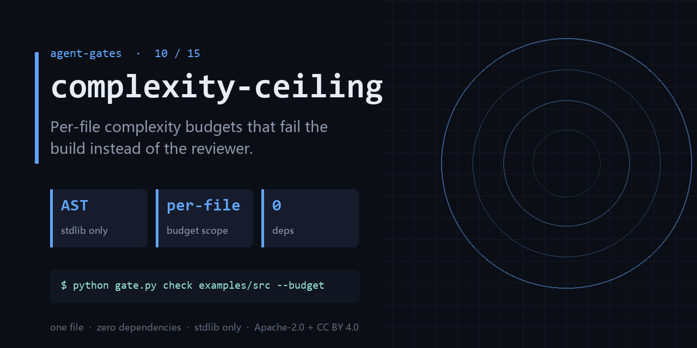

<div align="center">

</div>

<h1 align="center">complexity-ceiling</h1>

<p align="center"><b>Per-file complexity budgets that fail the build instead of the reviewer.</b><br><sub>one file · zero dependencies · stdlib only</sub></p>

<p align="center"><a href="https://github.com/chenhz01/complexity-ceiling/actions/workflows/gate.yml"></a>   </p>

---

## The failure this catches

- One function is 400 lines; changing a single line breaks three call sites.
- 'This is too complex' is the most common review comment and the least actionable.
- Complexity only ever gets complained about in review, never turned into a number.

One command, on a file you already have:

```bash
python gate.py check examples/src --budget examples/budget.json
```

<details>
<summary><b>Real output</b> — produced by the bundled <code>examples/</code>, not a mock-up</summary>

```text
scanned=2 violations=1 worst_cc=19
OVER examples/src/tangled.py:route cc=19 budget=10
```

</details>

## What it does

- Cyclomatic complexity per function, aggregated per file, checked against a budget.
- Exit codes make it a CI gate; `--report` writes a JSON trend file.
- Zero deps, stdlib `ast` only — works on any Python 3.9+ repo.

## What it does **not** do

- Complexity is a proxy, not a verdict. Simple code can still be wrong.
- Python only. Other languages need their own parser, not a config change.
- A ceiling stops growth; it does not refactor anything for you.

Being explicit here is cheaper than a wrong expectation later.

## Exit codes

`0` = clean, `1` = findings. Gate your pipeline on `$?`.

## Install

```bash
git clone https://github.com/chenhz01/complexity-ceiling
cd complexity-ceiling
python gate.py --help
```

Python 3.9+. Nothing to `pip install` — stdlib only.

## Use it in CI

```yaml
- name: complexity-ceiling
  run: python gate.py check examples/src --budget examples/budget.json
```

`action.yml` is included, so you can also reference the repo directly as a composite action.

## 中文速览

**复杂度上限门** — 按文件设复杂度上限，让构建失败，而不是让评审崩溃。

- 一个函数 400 行，改一行崩三处，谁也不敢动。
- 「这里太复杂了」是评审意见里最常见、也最无法执行的一句话。
- 复杂度只会在代码评审里被口头抱怨，从不会变成一个数字。

一行命令：`python gate.py check examples/src --budget examples/budget.json`

边界：Complexity is a proxy, not a verdict. Simple code can still be wrong.

## The gates

| # | gate | what it stops |
|---|---|---|
| 02 | **[loop-gate](https://github.com/chenhz01/loop-gate)** | Find where your agent looped, before it burns another run |
| 03 | **[permission-gate](https://github.com/chenhz01/permission-gate)** | Score how much more your agent can do than it should |
| 04 | **[context-gate](https://github.com/chenhz01/context-gate)** | Measure what truncation deletes, before the model starts guessing |
| 05 | **[instruction-gate](https://github.com/chenhz01/instruction-gate)** | Two of your instructions contradict each other. This finds them |
| 06 | **[output-gate](https://github.com/chenhz01/output-gate)** | Before AI-written text ships, run the four checks it always fails |
| 07 | **[memory-expiry-gate](https://github.com/chenhz01/memory-expiry-gate)** | Give every memory a TTL, then prove the expiry semantics actually hold |
| 08 | **[drift-gate](https://github.com/chenhz01/drift-gate)** | When embeddings drift, retrieval quietly rots. Fingerprint it |
| 09 | **[price-gate](https://github.com/chenhz01/price-gate)** | Your cost model is only as good as the price table under it |
| 10 | **complexity-ceiling** ← you are here | Per-file complexity budgets that fail the build instead of the reviewer |
| 11 | **[deadcode-gate](https://github.com/chenhz01/deadcode-gate)** | Quantify how much of the repo is dead, instead of guessing |
| 12 | **[docrot-gate](https://github.com/chenhz01/docrot-gate)** | Docs don't die at once. They rot one stale command at a time |
| 13 | **[leak-gate](https://github.com/chenhz01/leak-gate)** | Scan for internal detail before the doc leaves the building |
| 14 | **[backup-gate](https://github.com/chenhz01/backup-gate)** | A backup you have never verified is a rumor |
| 15 | **[trail-gate](https://github.com/chenhz01/trail-gate)** | Hash-chained agent audit trail — and it verifies its own chain |

## License

- Code: **Apache-2.0** — see [LICENSE](LICENSE)
- Docs and example data: **CC BY 4.0** — see [LICENSE-SPEC](LICENSE-SPEC)

Attribution required when you redistribute the documentation; code can be used commercially
without a separate agreement. See [NOTICE](NOTICE).
